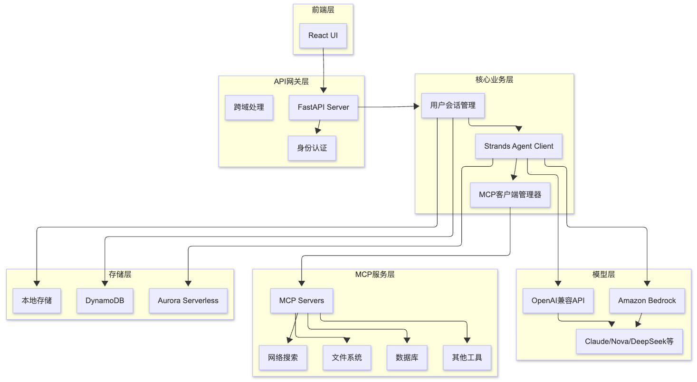

# Agentic AI with Strands Agents SDK 

## 1. Overview

This is a versatile Agentic AI application developed based on the Strands Agents SDK, which achieves seamless connection between large language models and external tool systems through MCP integration. Serving as the core engine, the Strands SDK provides powerful agent capabilities and tool integration mechanisms, endowing the entire system with high scalability and practicality.

### 1.1 Key Features
- **Decoupled Frontend and Backend** - Both MCP Client and MCP Server can be deployed on the server side, allowing users to interact directly through a web browser via the backend web service to access LLM and MCP Server capabilities and resources
- **React UI** - React-based user interface enabling users to interact with models, manage MCP servers, and display tool call results and reasoning processes
- **MCP Tool Integration** - Provides STDIO, StreamableHTTP, and SSE modes for MCP integration
- **Multiple Model Providers** - Support for Bedrock, OpenAI, and compatible models
- **Multi-user Session Management** - Maintains sessions for multiple users

### 1.2 Technical Features and Advantages
#### Architectural Benefits
- Modular Design: Clear layered architecture with well-defined component responsibilities
- Scalability: Support for various model providers and MCP protocols
- High Concurrency: Asynchronous processing and streaming response support
- Resource Management: Comprehensive session and connection lifecycle management

#### MCP Integration Benefits
- Standard Compatibility: Fully compatible with the Anthropic MCP standard
- Multi-protocol Support: Supports multiple transport protocols including Stdio, SSE, and StreamableHTTP
- Dynamic Management: Runtime dynamic addition and removal of MCP servers
- Tool Caching: Intelligent tool acquisition and caching mechanism

#### Strands SDK Benefits
- Unified Interface: Provides a unified agent interface for different model providers
- Intelligent Conversation Management: Built-in sliding window conversation manager
- Tool Integration: Native support for MCP tool integration
- Observability: Integration with observability tools like Langfuse

#### Application Scenarios
1. Enterprise Knowledge Assistant: Integration with internal systems and knowledge bases
2. Deep Research: Connection to search engines and knowledge repositories
3. Data Analysis Assistant: Connection to databases and BI tools for intelligent data analysis
4. Office Automation: Integration with calendar, email, document systems, and other office tools
5. Customer Service: Connection to CRM and ticketing systems for intelligent customer support

### 1.3 System Architecture Diagram


### 1.4 System Flow Diagram


## 2. Installation Method (Development Mode)
### 2.1 Dependencies Installation

Currently, mainstream MCP Servers are developed based on NodeJS or Python and run on users' PCs, so these dependencies need to be installed on the user's PC.

### 2.1 NodeJS

Download and install NodeJS from [here](https://nodejs.org/en). This project has been thoroughly tested with `v22.12.0`.

### 2.2 Python

Some MCP Servers are developed in Python, so users must install [Python](https://www.python.org/downloads/). Additionally, this project's code is also Python-based, requiring environment setup and dependencies.

First, install the Python package management tool uv. For details, refer to the [uv](https://docs.astral.sh/uv/getting-started/installation/) official guide.

### 2.3 Environment Configuration
After downloading or cloning the project, navigate to the project directory, create a Python virtual environment, and install dependencies:
```bash
uv sync
```

### 2.4 Environment Variables Setup
Rename env.example to .env and modify the following variables as needed:

- For using Bedrock overseas (default)
```bash
STRANDS_MODEL_PROVIDER=bedrock
AWS_ACCESS_KEY_ID=your_access_key
AWS_SECRET_ACCESS_KEY=your_secret_key
AWS_REGION=us-east-1
```

- For using OpenAI-compatible models like SiliconFlow
```bash
AWS_REGION=cn-north-1
CLIENT_TYPE=strands
STRANDS_MODEL_PROVIDER=openai
OPENAI_API_KEY=your_openai_api_key
OPENAI_BASE_URL=https://api.siliconflow.cn/v1
```

- The default configuration supports models like `DeepSeek-R1` and `Qwen3`. To support other models (must be tool use compatible), modify the [conf/config.json](conf/config.json) configuration, for example:

```json
  {
    "model_id": "Qwen/Qwen3-235B-A22B",
    "model_name": "Qwen3-235B-A22B"
  },
  {
    "model_id": "Qwen/Qwen3-30B-A3B",
    "model_name": "Qwen3-30B-A3B"
  },
  {
    "model_id": "Pro/deepseek-ai/DeepSeek-R1",
    "model_name": "DeepSeek-R1-Pro"
  },
  {
    "model_id": "deepseek-ai/DeepSeek-V3",
    "model_name": "DeepSeek-V3-free"
  }
```

### 2.4 Create a Cognito User Pool (User Authentication)
Every API request must carry the signed-in user's Amazon Cognito access token. The backend verifies the token signature and takes the user ID from the token's `sub` claim; it never trusts a user ID supplied by the client. A CDK deployment creates the user pool for you; for local development create one manually:
```bash
# Create the user pool (only administrators can create users, sign in with email)
aws cognito-idp create-user-pool --pool-name strands-mcp-users \
    --username-attributes email --auto-verified-attributes email \
    --admin-create-user-config AllowAdminCreateUserOnly=true \
    --policies 'PasswordPolicy={MinimumLength=12,RequireUppercase=true,RequireLowercase=true,RequireNumbers=true,RequireSymbols=true}'
# Create an app client without a client secret (note the UserPool Id and ClientId in the output)
aws cognito-idp create-user-pool-client --user-pool-id <UserPoolId> --client-name web \
    --no-generate-secret --explicit-auth-flows ALLOW_USER_SRP_AUTH ALLOW_REFRESH_TOKEN_AUTH \
    --prevent-user-existence-errors ENABLED
# Create a user (they set a new password at first sign-in)
aws cognito-idp admin-create-user --user-pool-id <UserPoolId> --username you@example.com
```
Put `COGNITO_USER_POOL_ID` and `COGNITO_APP_CLIENT_ID` in both the backend `.env` and the frontend `react_ui/.env.local`. Cognito user pools are not available in China regions; use a user pool in a global region.

### 2.4 Create a DynamoDB Table Named mcp_user_config_table
```bash
aws dynamodb create-table \
    --table-name mcp_user_config_table \
    --attribute-definitions AttributeName=userId,AttributeType=S \
    --key-schema AttributeName=userId,KeyType=HASH \
    --billing-mode PAY_PER_REQUEST 
```

### 2.5 Starting the Backend Service

- Start the backend service:
```bash
bash start_all.sh
```

### 2.6 Frontend
**Prerequisites**
- Install Docker and Docker Compose: https://docs.docker.com/get-docker/
- Docker installation command for Linux:
```bash
# Install Docker
curl -fsSL https://get.docker.com -o get-docker.sh
sudo sh get-docker.sh

# Install Docker Compose
sudo curl -L "https://github.com/docker/compose/releases/download/v2.24.6/docker-compose-$(uname -s)-$(uname -m)" -o /usr/local/bin/docker-compose
sudo chmod +x /usr/local/bin/docker-compose
ln -s /usr/bin/docker-compose  /usr/local/bin/docker-compose
```
1. After cloning the repository
```bash
cd demo_mcp_on_amazon_bedrock/react_ui
```

2. Create environment variable file
```bash
cp .env.example .env.local
```

3. Build and start services using Docker Compose
```bash
docker-compose up -d --build
```

#### Other Useful Docker Commands
```bash
# View container logs
docker logs -f mcp-bedrock-ui

# Restart container
docker-compose restart

# Stop container
docker-compose down

# Rebuild and start (after code updates)
docker-compose up -d --build
```

## 3. Installation Method (Production Mode, AWS ECS Deployment)
Please refer to the [CDK Deployment Guide](cdk/README-CDK_en.md)

This demo's deployment architecture follows AWS best practices, deploying the application in private subnets, providing public access through a load balancer, and using Fargate for serverless container management. The deployment architecture includes the following main AWS components:

1. ECS Cluster:
   • Serverless container environment running on Fargate using ARM architecture
   • Frontend service: Minimum 2 tasks, auto-scaling based on CPU usage
   • Backend service: Minimum 2 tasks, auto-scaling based on CPU usage

2. VPC:
   • Contains public and private subnets spanning 2 availability zones
   • Internet Gateway and NAT Gateway in public subnets
   • Private subnets for running ECS tasks

3. Application Load Balancer:
   • Application Load Balancer (ALB) distributes traffic
   • Routes requests with /v1/* and /api/* paths to the backend service
   • Routes other requests to the frontend service

4. Data Storage:
   • DynamoDB table for storing user configurations

5. Security Components:
   • IAM roles and policies control access permissions
   • An Amazon Cognito user pool handles user sign-in; the backend verifies the access token on every request. After deployment, create users with the `CognitoUserPoolId` stack output: `aws cognito-idp admin-create-user --user-pool-id <CognitoUserPoolId> --username you@example.com`
   • Security groups control network traffic

6. Container Images:
   • Frontend and backend container images stored in ECR

## 4. More Examples
- [case](./README_cases.md)