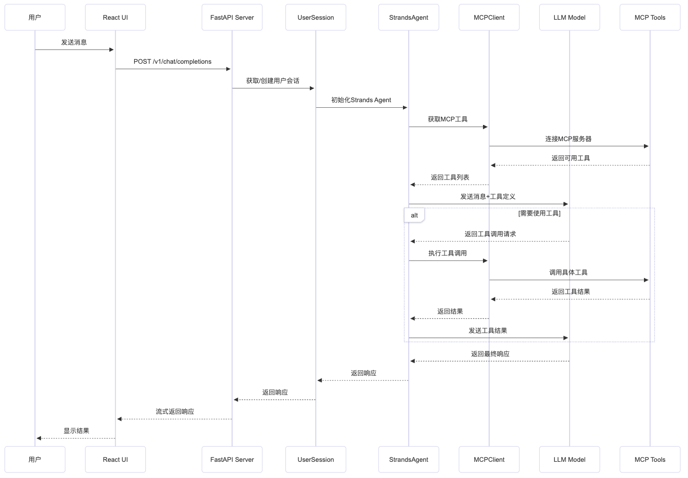

# Agentic AI with Strands Agents SDK [English](./README.en.md)

本方案对应blog:[亚马逊云科技中国区构建 Agentic AI 应用实践指南](https://aws.amazon.com/cn/blogs/china/practical-guide-to-building-agentic-ai-applications-for-aws-china-region/)

## 1.概述

这是基于Strands Agents SDK开发的通用型Agentic AI应用，通过MCP的集成，实现了大语言模型与外部工具系统的无缝连接。Strands SDK作为核心引擎，提供了强大的代理能力和工具集成机制，使得整个系统具备了高度的可扩展性和实用性。

### 1.1 功能特点
- **前后端分离** - MCP Client和MCP Server均可以部署到服务器端，用户可以直接使用web浏览器通过后端web服务交互，从而访问LLM和MCP Sever能力和资源
- **React UI** - 基于React的用户界面，允许用户与模型交互并管理MCP服务器，显示工具调用结果和思考过程
- **MCP 工具集成** - 提供STDIO, StreamableHTTP, SSE模式的MCP集成
- **多模型提供商** - 支持 Bedrock、OpenAI及兼容模型
- **多用户会话管理** - 维护多用户session

### 1.2 技术特色与优势
#### 架构优势
- 模块化设计 : 清晰的分层架构，各组件职责明确
- 可扩展性 : 支持多种模型提供商和MCP协议
- 高并发 : 异步处理和流式响应支持
- 资源管理 : 完善的会话和连接生命周期管理

#### MCP集成优势
- 标准兼容 : 完全兼容Anthropic MCP标准
- 多协议支持 : 支持Stdio、SSE、StreamableHTTP等多种传输协议
- 动态管理 : 支持运行时动态添加和移除MCP服务器
- 工具缓存 : 智能的工具获取和缓存机制

#### Strands SDK优势
- 统一接口 : 为不同模型提供商提供统一的代理接口
- 智能对话管理 : 内置滑动窗口对话管理器
- 工具集成 : 原生支持MCP工具集成
- 可观测性 : 集成Langfuse等可观测性工具

#### 应用场景
1. 企业知识助手 : 集成企业内部系统和知识库
2. DeepResearch  : 连接搜索，知识库等工具
3. 数据分析助手 : 连接数据库、BI工具进行智能数据分析
4. 办公自动化 : 集成日历、邮件、文档系统等办公工具
5. 客户服务 : 连接CRM、工单系统提供智能客服


### 1.3 系统架构图


### 1.4 系统流程图



## 2.安装方法（开发模式）
### 2.1. 依赖安装

目前主流 MCP Server 基于 NodeJS 或者 Python 开发实现并运行于用户 PC 上，因此用户 PC 需要安装这些依赖。

### 2.1 NodeJS

NodeJS [下载安装](https://nodejs.org/en)，本项目已对 `v22.12.0` 版本充分测试。

### 2.2 Python

有些 MCP Server 基于 Python 开发，因此用户必须安装 [Python](https://www.python.org/downloads/)。此外本项目代码也基于 Python 开发，需要安装环境和依赖。

首先，安装 Python 包管理工具 uv，具体可参考 [uv](https://docs.astral.sh/uv/getting-started/installation/) 官方指南

### 2.3 环境配置
下载克隆该项目后，进入项目目录创建 Python 虚拟环境并安装依赖：
```bash
uv sync
```

### 2.4 环境变量设置
把env.example 改成.env,根据情况取消注释，修改以下变量：
进入项目目录
```bash
cd ./sample_agentic_ai_strands
cp env.example .env
```
  
使用vim 打开.env文件编辑：
⚠️如果在x86服务器做编译，可以设置PLATFORM=linux/amd64，否则跨平台编译速度慢好几倍
```bash
# for Development mode - ddb for user config
ddb_table=mcp_user_config_table
# 用户认证 - Amazon Cognito 用户池（必填，见2.4节；CDK部署会自动创建并设置）
COGNITO_USER_POOL_ID=
COGNITO_APP_CLIENT_ID=
# =============================================================================
# AWS Infra CONFIGURATION
# The default ECS platform is arm64, you can choose linux/amd64 
# =============================================================================
PLATFORM=linux/amd64
AWS_REGION=your_region_to_deploy(必须填，方案部署区，例如如果是北京区用cn-north-1)
AWS_ACCESS_KEY_ID=
AWS_SECRET_ACCESS_KEY=

# =============================================================================
# 如果在全球区，使用bedrock模型，需要如下Strands 配置
# AWS BEDROCK CONFIGURATION (for Bedrock provider, if not set, it will use same credential as AWS Infra)
# =============================================================================
STRANDS_MODEL_PROVIDER=bedrock
BEDROCK_AWS_ACCESS_KEY_ID=your_aws_access_key_id
BEDROCK_AWS_SECRET_ACCESS_KEY=your_aws_secret_access_key
BEDROCK_AWS_REGION=us-east-1

# ============================
# 如果在中国区，使用openai兼容接口的模型，需要如下Strands 配置
# ============================
STRANDS_MODEL_PROVIDER=openai
OPENAI_API_KEY=your-model-provider-key
OPENAI_BASE_URL=your-model-provider-base-url(例如https://api.siliconflow.cn/v1)

# ============================
# Langfuse 配置 (可选) 
# ============================
#LANGFUSE_PUBLIC_KEY=your-public-key
#LANGFUSE_SECRET_KEY=your-secret-key
#LANGFUSE_HOST=https://your-langfuse-host

# =============================================================================
# mem0 CONFIGURATION
# Only used if ENABLE_MEM0=true
# If STRANDS_MODEL_PROVIDER=bedrock, it will use models in Bedrock
# =============================================================================
# 使用mem0将额外增加8-10分钟的部署时间
# 如果需要启用mem0，可以更改`ENABLE_MEM0=true`
ENABLE_MEM0=false

# 如果使用海外区
LLM_MODEL=us.amazon.nova-pro-v1:0
EMBEDDING_MODEL=amazon.titan-embed-text-v2:0

# 如果使用国内硅基流动https://api.siliconflow.cn/v1
LLM_MODEL=Qwen/Qwen3-14B
EMBEDDING_MODEL=Pro/BAAI/bge-m3
```  
如果需要可观测性，可以去`https://us.cloud.langfuse.com/` 注册一个免费账号，然后把key和host信息填入上面的.env中，也可以参考[私有化部署](https://github.com/awslabs/amazon-bedrock-agent-samples/tree/main/examples/agent_observability/deploy-langfuse-on-ecs-fargate-with-typescript-cdk)


- 默认配置支持`DeepSeek-R1`,`Qwen3`等模型, 如果需要支持其他模型（必须是支持tool use的模型），请自行修改[conf/config.json](conf/config.json)配置加入模型，例如：

```json
  {
    "model_id": "Qwen/Qwen3-235B-A22B",
    "model_name": "Qwen3-235B-A22B"
  },
  {
    "model_id": "Qwen/Qwen3-30B-A3B",
    "model_name": "Qwen3-30B-A3B"
  },
  {
    "model_id": "Pro/deepseek-ai/DeepSeek-R1",
    "model_name": "DeepSeek-R1-Pro"
  },
  {
    "model_id": "deepseek-ai/DeepSeek-V3",
    "model_name": "DeepSeek-V3-free"
  }
```

### 2.4 创建Cognito用户池（用户认证）
所有API请求都必须携带已登录用户的Amazon Cognito访问令牌（access token），后端验证令牌签名后，从令牌的`sub`声明中取得用户ID，不信任客户端传入的任何用户ID。使用CDK部署时会自动创建用户池；本地开发需要手动创建：
```bash
# 创建用户池（仅管理员可创建用户，邮箱登录）
aws cognito-idp create-user-pool --pool-name strands-mcp-users \
    --username-attributes email --auto-verified-attributes email \
    --admin-create-user-config AllowAdminCreateUserOnly=true \
    --policies 'PasswordPolicy={MinimumLength=12,RequireUppercase=true,RequireLowercase=true,RequireNumbers=true,RequireSymbols=true}'
# 创建不带client secret的应用客户端（记下输出中的UserPool Id和ClientId）
aws cognito-idp create-user-pool-client --user-pool-id <UserPoolId> --client-name web \
    --no-generate-secret --explicit-auth-flows ALLOW_USER_SRP_AUTH ALLOW_REFRESH_TOKEN_AUTH \
    --prevent-user-existence-errors ENABLED
# 创建用户（用户首次登录时设置新密码）
aws cognito-idp admin-create-user --user-pool-id <UserPoolId> --username you@example.com
```
把`COGNITO_USER_POOL_ID`和`COGNITO_APP_CLIENT_ID`同时写入后端`.env`和前端`react_ui/.env.local`。中国区不提供Cognito用户池，请使用全球区域的用户池。

### 2.4 创建一个dynamodb table, 名称为`mcp_user_config_table`
```bash
aws dynamodb create-table \
    --table-name mcp_user_config_table \
    --attribute-definitions AttributeName=userId,AttributeType=S \
    --key-schema AttributeName=userId,KeyType=HASH \
    --billing-mode PAY_PER_REQUEST 
```


### 2.5 启动后端服务

- 启动后端服务：
```bash
bash start_all.sh
```

### 2.6 前端
**前提条件**
- 安装Docker和Docker Compose：https://docs.docker.com/get-docker/
- Linux下安装Docker命令：
```bash
# 安装Docker
curl -fsSL https://get.docker.com -o get-docker.sh
sudo sh get-docker.sh

# 安装Docker Compose
sudo curl -L "https://github.com/docker/compose/releases/download/v2.24.6/docker-compose-$(uname -s)-$(uname -m)" -o /usr/local/bin/docker-compose
sudo chmod +x /usr/local/bin/docker-compose
ln -s /usr/bin/docker-compose  /usr/local/bin/docker-compose
```
1. 克隆仓库之后
```bash
cd demo_mcp_on_amazon_bedrock/react_ui
```

2. 创建环境变量文件
```bash
cp .env.example .env.local
```

3. 使用Docker Compose构建并启动服务
```bash
docker-compose up -d --build
```

#### 其他Docker常用命令
```bash
# 查看容器日志
docker logs -f mcp-bedrock-ui

# 重启容器
docker-compose restart

# 停止容器
docker-compose down

# 重新构建并启动（代码更新后）
docker-compose up -d --build
```

## 3.安装方法（生产模式，AWS ECS部署）
请参考 [CDK部署说明](cdk/README-CDK.md)

 这个Demo的部署架构遵循AWS最佳实践，将应用程序部署在私有子网中，通过负载均衡器提供公共访问，并使用Fargate实现无服务器容器管理。 这个部署架构包含以下主要亚马逊云组件：
1. ECS Cluster：
 • 运行在Fargate上的无服务器容器环境, 使用ARM架构
 • 前端服务：最小2个任务，根据CPU使用率自动扩展
 • 后端服务：最小2个任务，根据CPU使用率自动扩展

2.  VPC ：
 • 包含公有子网和私有子网，跨越2个可用区
 • 公有子网中有Internet Gateway和NAT Gateway
 • 私有子网用于运行ECS任务

3. 应用负载均衡：
 • 应用负载均衡器(ALB)分发流量
 • 将/v1/*和/api/*路径的请求路由到后端服务
 • 将其他请求路由到前端服务

4. 数据存储：
 • DynamoDB表用于存储用户配置

5. 安全组件：
 • IAM角色和策略控制访问权限
 • Amazon Cognito用户池负责用户登录，后端校验每个请求的访问令牌。部署完成后用Stack输出的`CognitoUserPoolId`创建用户：`aws cognito-idp admin-create-user --user-pool-id <CognitoUserPoolId> --username you@example.com`
 • 安全组控制网络流量

6. 容器镜像：
 • 前端和后端容器镜像存储在ECR中


## 4.更多示例
- [case](./README_cases.md)