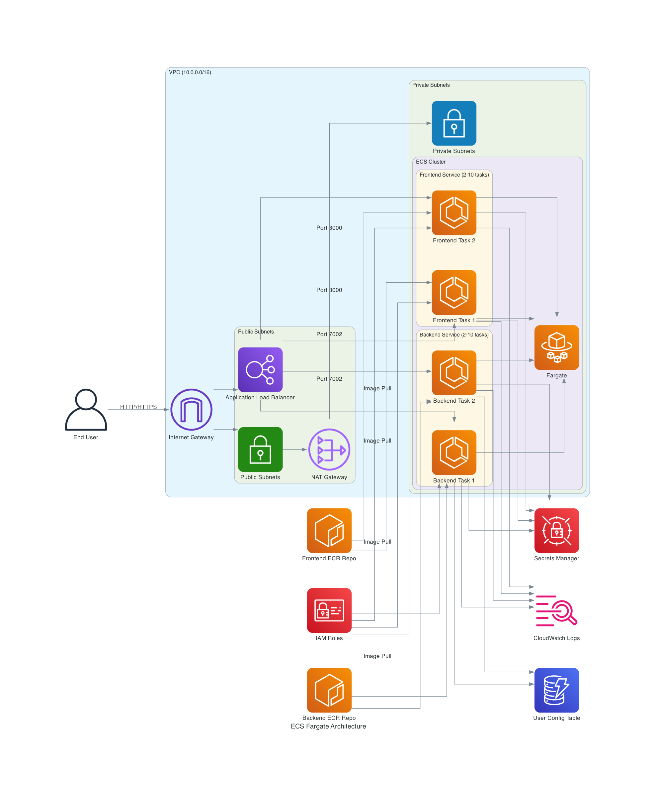

# AWS CDK 部署指南

使用 AWS CDK (Cloud Development Kit) 部署 MCP 应用到 ECS Fargate 的完整指南。

## CDK 架构概述

 这个Demo的部署架构遵循AWS最佳实践，将应用程序部署在私有子网中，通过负载均衡器提供公共访问，并使用Fargate实现无服务器容器管理。 这个部署架构包含以下主要亚马逊云组件：
1. ECS Cluster：
 • 运行在Fargate上的无服务器容器环境, 使用ARM架构
 • 前端服务：最小2个任务，根据CPU使用率自动扩展
 • 后端服务：最小2个任务，根据CPU使用率自动扩展

2.  VPC ：
 • 包含公有子网和私有子网，跨越2个可用区
 • 公有子网中有Internet Gateway和NAT Gateway
 • 私有子网用于运行ECS任务

3. 应用负载均衡：
 • 应用负载均衡器(ALB)分发流量
 • 将/v1/*和/api/*路径的请求路由到后端服务
 • 将其他请求路由到前端服务

4. 数据存储：
 • DynamoDB表用于存储用户配置

5. 安全组件：
 • IAM角色和策略控制访问权限
 • Amazon Cognito用户池负责用户登录（仅管理员可创建用户）
 • 安全组控制网络流量

6. 容器镜像：
 • 前端和后端容器镜像存储在ECR中

### 网络架构
- **VPC**: 10.0.0.0/16 跨 2 个可用区
- **公有子网**: 10.0.1.0/24, 10.0.2.0/24 (ALB)
- **私有子网**: 10.0.3.0/24, 10.0.4.0/24 (ECS容器)
- **NAT Gateway**: 为私有子网提供互联网访问
- **Internet Gateway**: 公有网络访问

### 计算和存储
- **ECS Fargate 集群**: ARM64 架构容器运行时
- **DynamoDB 表**: 用户配置存储 (按需计费)
- **ECR 仓库**: 前端和后端 Docker 镜像存储

### 安全和配置
- **Amazon Cognito**: 用户池和Web应用客户端，后端校验每个请求的访问令牌
- **Secrets Manager**: 安全存储模型和凭证配置
- **IAM 角色**: 最小权限原则
- **安全组**: 网络访问控制

### 负载均衡和监控
- **Application Load Balancer**: HTTP/HTTPS 流量分发
- **CloudWatch Logs**: 应用日志收集
- **Auto Scaling**: CPU 使用率自动伸缩

## 快速开始

### 环境要求

1. **Node.js** (版本 18+)
2. **AWS CLI** 已配置
3. **Docker** 支持 buildx (多架构构建)
4. **AWS CDK** CLI 工具

```bash
# 安装 CDK CLI
npm install -g aws-cdk
npm install -g typescript
npm install
npm i --save-dev @types/node


# 验证安装
cdk --version
```

#### 中国区安装需要设置docker 镜像源
使用 `sudo vim /etc/docker/daemon.json`,添加代理
```json
{
"registry-mirrors":["https://mirror-docker.bosicloud.com"],
"insecure-registries":["mirror-docker.bosicloud.com"]
}
```

## 详细部署步骤
### 步骤 1: 配置AWS credentials
```bash
aws configure
```

### 步骤 1: 准备环境

确保 `.env` 文件包含所有必要的配置：

```bash
# 如果在Global Region需要使用Bedrock，配置如下
AWS_ACCESS_KEY_ID=your-access-key
AWS_SECRET_ACCESS_KEY=your-secret-key
AWS_REGION=us-east-1
STRANDS_MODEL_PROVIDER=bedrock


# 如果在中国区，使用openai兼容接口的模型，需要如下Strands 配置
OPENAI_API_KEY=your-model-provider-key
OPENAI_BASE_URL=your-model-provider-base-url(例如https://api.siliconflow.cn)
STRANDS_MODEL_PROVIDER=openai
AWS_REGION=cn-northwest-1(方案部署区，如果是北京区用cn-north-1)

# Langfuse 配置 (可选)
LANGFUSE_PUBLIC_KEY=your-public-key
LANGFUSE_SECRET_KEY=your-secret-key
LANGFUSE_HOST=https://your-langfuse-host

# 其他配置
CLIENT_TYPE=strands
MAX_TURNS=200
INACTIVE_TIME=1440
```

### 部署脚本
```bash
cd cdk
bash cdk-build-and-deploy.sh
```

### 步骤 4: 创建登录用户
用户池不开放自助注册。部署完成后，用Stack输出的`CognitoUserPoolId`创建用户，用户首次登录时设置新密码：
```bash
aws cognito-idp admin-create-user --user-pool-id <CognitoUserPoolId> --username you@example.com
```
中国区不提供Cognito用户池：部署前设置`COGNITO_USER_POOL_ID`和`COGNITO_APP_CLIENT_ID`，指向全球区域已有的用户池和不带client secret的应用客户端。

### 步骤 5: 更新服务
```bash
bash update-ecs-services.sh
```

## CDK 命令参考

### 基本命令

```bash
# 查看将要部署的资源
cdk diff

# 部署 Stack
cdk deploy

# 销毁 Stack
cdk destroy

# 列出所有 Stack
cdk list

# 查看 Stack 模板
cdk synth
```

### 有用的选项

```bash
# 跳过确认
cdk deploy --require-approval never

# 指定 Stack 名称
cdk deploy McpEcsFargateStack

# 设置 AWS 配置文件
cdk deploy --profile your-profile

# 输出模板到文件
cdk synth > template.yaml
```

### 多环境部署
使用 CDK 上下文变量：

```bash
# 部署到不同环境
cdk deploy --context env=staging
cdk deploy --context env=production
```

## 清理资源

完全删除所有创建的资源：

```bash
# 删除 CDK Stack
cdk destroy

# 清理 ECR 仓库
aws ecr delete-repository --repository-name mcp-app-frontend --force
aws ecr delete-repository --repository-name mcp-app-backend --force

# 删除 CloudWatch 日志组
aws logs delete-log-group --log-group-name "/ecs/mcp-app-frontend"
aws logs delete-log-group --log-group-name "/ecs/mcp-app-backend"
```

注意：某些资源（如 DynamoDB 表）可能有删除保护，需要手动确认删除。
